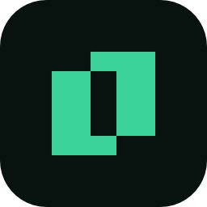

<div align="center">



# Northlight branding

**The logo, colors and type of Northlight, and the mascot and screenshots of Platty.**

</div>

---

## 🟩 The mark

Two columns on a 16 by 16 grid, offset so they cross, with the crossing left empty. The
slot in the middle is the light coming through. The mark is two solid shapes that touch
only at two corners, so it stays crisp at 16 px.

| File | What it is |
| --- | --- |
| `logo/northlight-mark-aurora.svg` | The mark in Aurora green |
| `logo/northlight-mark-white.svg` | White, for dark or colored backgrounds |
| `logo/northlight-mark-black.svg` | Black, for single color print |
| `png/mark/northlight-mark-<color>-<n>.png` | The mark on a transparent background (16 to 1024 px) |

## 🔤 The logo

The mark next to the wordmark set in Geist Bold, tracked at -0.025 em. The wordmark is
converted to outlines, so the files need no font installed.

| File | Use it on |
| --- | --- |
| `logo/northlight-logo-light.svg` | Light backgrounds: Aurora mark, Ink wordmark |
| `logo/northlight-logo-dark.svg` | Dark backgrounds: Aurora mark, white wordmark |
| `logo/northlight-logo-white.svg` | Photos and colored backgrounds |
| `logo/northlight-logo-black.svg` | Single color print |
| `logo/northlight-logo-stacked-<variant>.svg` | Square spaces: mark above the wordmark |
| `png/logo/northlight-logo-<variant>-<h>.png` | Horizontal logo, 64, 128 and 256 px tall |

**Clear space:** keep a quarter of the mark's height free on every side.
**Minimum size:** 16 px for the mark, 16 px tall for the horizontal logo.

## 📱 App icon

The Aurora mark on a Night rounded square.

| File | What it is |
| --- | --- |
| `icon/northlight-icon.svg` | Vector icon (1024 px canvas) |
| `icon/northlight-icon-<n>.png` | 16 to 1024 px |
| `icon/northlight.ico` | Windows icon (16 to 256 px) |

## 🌐 Social

| File | What it is |
| --- | --- |
| `social/northlight-github-avatar.png` | GitHub organization avatar: Aurora on Night (1024 px) |
| `social/northlight-github-avatar-aurora.png` | Alternative avatar: Night on Aurora |
| `social/northlight-og-1200x630.png` | Link preview image for the website and repos |

## 🎨 Color

| Token | Hex | Use |
| --- | --- | --- |
| Aurora | `#3BD39A` | The brand color: the mark, highlights, primary actions on dark |
| Aurora Strong | `#0F7A52` | Aurora for text and links on light backgrounds |
| Aurora Soft | `#C9F3E0` | Tints and selected states on light |
| Glacier | `#6CB6F0` | Secondary accent, kept for products |
| Night | `#08130F` | Darkest background |
| Graphite | `#111E19` | Surfaces on dark |
| Slate | `#1C2B25` | Borders on dark |
| Mist | `#8FA39A` | Secondary text on dark |
| Stone | `#5B6F66` | Secondary text on light |
| Haze | `#DCE6E0` | Borders on light |
| Paper | `#F4F8F5` | Light background |
| Ink | `#0B1A14` | Text on light |

The neutrals carry a slight green tint so they sit with Aurora. `tokens/colors.css` and
`tokens/tokens.json` hold the same values for code.

## ✍️ Type

**Geist** for everything: Bold for the wordmark and headlines, Medium and Regular for
interface and body text. **Geist Mono** for code, terminals and data. Both are free under
the SIL Open Font License.

## 🛠️ Regenerating

Every logo, icon and image above comes from `tools/brandgen`, a small Go program that
draws the mark and outlines the wordmark from Geist Bold:

```
cd tools/brandgen
go run . path/to/Geist-Bold.ttf ../..
```

## ☀️ Sol, the Platty mascot

A wavy white body inside a light grey glass ring, with two glass eyes. Sol is drawn with
vectors in Platty's `internal/ui/mascot` package; the files here are exports of that drawing.

| File | What it is |
| --- | --- |
| `mascot/sol-<n>.png` | Sol on a transparent background (16 to 1024 px) |
| `mascot/sol-light-<n>.png` | White glass with a dark rim, for light backgrounds |
| `mascot/sol-happy-<n>.png` | Smiling eyes (^ ^) |
| `mascot/sol-dark-<n>.png` | On Platty's dark background |
| `mascot/sol.gif` | Looping animation (4.2 s, 25 fps): the waves flow, Sol blinks and looks around |
| `mascot/frames/sol-NNN.png` | The 105 animation frames, with transparency |
| `mascot/platty.ico` | Windows icon (16 to 256 px) |
| `mascot/github/platty-github-*.png` | Former GitHub organization avatar (1024 px): black, graphite and pure |

## 🖼️ Screenshots

`screens/` holds the Platty screenshots used by its README and website, named
`<screen>-<theme>.png` (Carbon, Graphite, Midnight and Paper themes).

## 🔗 Linking

Link files from other repositories through their raw URL:

```
https://raw.githubusercontent.com/northlighthq/branding/main/icon/northlight-icon-256.png
```
